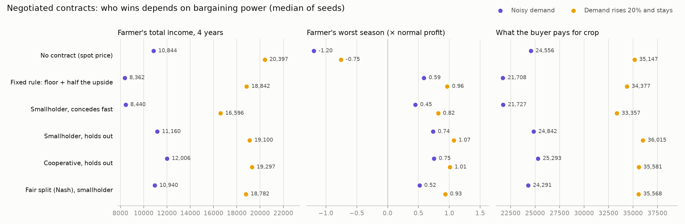

# Farm-to-Shelf Beer Game

**Who carries the risk when a food supply chain coordinates?** A simulation
that starts at the farm and tests data sharing, supply contracts and
negotiating agents.

**[▶ Try the interactive demo](https://careneA.github.io/farm-beer-game/demo/)** ·
**[Read the report](REPORT.md)**



### Key findings (in this model)

1. **The bullwhip effect is worst at the farm.** Playing alone, the factory's
   orders to the farm vary over 500× more than customer demand.
2. **Sharing data calms the chain, but not the farmer.** Farmers still plant
   for today's price, and the boom-and-bust cycle gives them losing seasons.
3. **A quantity commitment, not a fixed price, protects farmers.** Every
   contract kept the farmer's worst season profitable; a government-set price
   without a quantity commitment did not.
4. **Bargaining power decides who keeps the gains.** A smallholder who needs a
   deal fast earns 23% below a fair split, and a cooperative earns 10% above it.
5. **First AI test:** Claude, negotiating for the smallholder, bargained
   almost exactly like the farmer who concedes fast (one 2-year game).

Built with Python and NumPy. The demo runs the same Python model in the
browser with [Pyodide](https://pyodide.org), so the demo and the report always
agree.

---

## About the model

```
farm  ->  factory  ->  distributor  ->  wholesaler  ->  retailer  ->  customers
```

The classic MIT Beer Game stops at the factory and gives it unlimited raw
material. This version adds a farm that:

- **plants once per season** (26 weeks from planting to harvest),
- **can't control its harvest** (yield varies about ±15%),
- **loses crop that sits too long** (it spoils after 30 weeks),
- **can't plant more than its land allows** (1.6× a normal season),
- **sells at a farmgate price that moves with scarcity** and pays to plant,
  so you can follow the farmer's income season by season.

## Setup

Needs Python 3.10 or newer.

```bash
git clone https://github.com/careneA/farm-beer-game.git
cd farm-beer-game
python3 -m venv .venv
.venv/bin/pip install -r requirements.txt
```

To open the demo locally, serve the project folder and open
http://127.0.0.1:8765/demo/:

```bash
python3 -m http.server 8765 --bind 127.0.0.1
```

## Run the experiments

```bash
.venv/bin/python run_experiments.py
```

This runs 3 strategies × 3 demand patterns × 30 random seeds, plus a price
sensitivity check, in about 5 seconds.
It prints a summary table and writes to `results/`:

| File | What it holds |
|---|---|
| `runs.csv` | every run, one row each |
| `summary.csv`, `summary.md` | median of each metric per strategy and demand pattern |
| `bullwhip_by_stage.png` | how much each player amplifies demand |
| `spike_orders.png` | one panic-buying run: what the farm actually hears |
| `farm_outcomes.png` | planting swings and farm shortages |
| `farm_money.png` | farmgate price over time, and the farmer's worst season |

### Prices

| Piece | How it works |
|---|---|
| Spot price | Each week it moves toward a level set by demand pressure (recent orders plus a share of backlog) divided by supply (crop on hand spread over the weeks until the next harvest). Between 0.4× and 3× the normal price. |
| Growing cost | 0.6 per unit planted, paid at planting. A balanced market pays 1.0, so normal profit is 0.4 per unit. |
| Farmer's reaction | Farmers plant more when recent prices are high (`price_response`, default 0.5). This is the "hog cycle": the high price that tells them to plant more is gone by the time the crop arrives. |
| Contract price | Locked in at signing: last season's average spot price. Contracted units are paid at that price, and any extra units at spot. |

### Strategies

| Strategy | What changes |
|---|---|
| `baseline` | Every player sees only the orders it receives. Players follow the rule Sterman (1989) fitted to people playing the game: they close inventory gaps slowly and forget about two thirds of what they already ordered. The farmer plants for the factory's recent orders. |
| `info_sharing` | Everyone, the farmer included, sees real customer demand and counts everything already on order. |
| `forward_contract` | Info sharing, plus at each planting the factory commits to a weekly quantity for the season. The farm plants for it and delivers it every week. The factory can buy more, but never less. |

### Demand patterns

`noisy` (no shock) · `step` (demand rises 20% at week 30 and stays there) · `spike` (panic buying: +60% for 8 weeks)

## Results: strategies (30 seeds, medians)

| Noisy demand unless noted | Baseline | Info sharing | + Contract |
|---|---|---|---|
| Bullwhip at factory | **562×** | 0.7× | 0.2× |
| Farm planting swing | 0.61 | 0.35 | 0.07 |
| Weeks the farm can't fill orders | 46% | 14% | 5% |
| Weeks with empty shelves | 9% | 0.3% | 0% |
| Whole-chain cost | 543k | 154k | 146k |
| Average farmgate price | 1.95 | 1.30 | 1.08 |
| Farmer income, 4 years | 21.6k | 10.8k | 10.0k |
| Farmer's worst season (× normal profit) | −0.15 | **−1.20** | **+0.15** |
| Weeks with empty shelves, step (+20%) | 24% | 1% | 0% |

What this suggests so far:

1. **The bullwhip grows at every step toward the farm.** With noisy demand and no
   shocks, the factory's orders vary hundreds of times more than what customers buy.
2. **After a shock, the farm turns a short problem into a long one.** The farm
   can't replant until next season, so the shortage lasts months, players panic
   order, and the chain stays out of balance for years.
3. **Sharing demand data calms the chain, but not the farmer.** Order swings drop
   to about 1×. But farmers still plant for today's price, so prices swing between
   0.4× and 3× and the farmer's worst season is a loss bigger than a normal
   season's profit. Information alone doesn't stop the hog cycle.
4. **The contract is what protects the farmer.** Plantings become steady and the
   worst season stays profitable. That holds however strongly farmers chase
   prices (`farm_money.png`, right panel). With information sharing alone, the
   worst season gets worse the more farmers chase prices.
5. **The chaotic chain pays the farmer the most.** Under baseline, constant
   shortages keep prices near the 3× cap, so total farm income is about double.
   The rest of the chain pays for it in shortages and costs. A calmer chain
   gives farmers stability, not more money. How the gains get split depends on
   the contract price, and that is the real negotiation question.
6. **The contract moves risk to the factory.** The factory has to take the
   committed amount, so its costs rise. Because the contract amount is fixed for
   a season, the farm also runs short a bit more often after a lasting demand
   change.

## Compare contract designs

```bash
.venv/bin/python compare_contracts.py
```

Every design below shares demand information. Only the way the farmer is paid
changes. The output goes to `results/contract_designs.csv`, `.md` and `.png`.

| Design | How the farmer is paid |
|---|---|
| No contract | Spot price for everything |
| Contract: last season's price | Committed weekly quantity, at last season's average spot price |
| Contract: fixed price | Committed weekly quantity, always at 1.0 |
| Contract: floor + half the upside | Committed weekly quantity, at 1.0 plus half of any spot move above 1.0, never below 0.8 |
| Government farmgate (70%) | No quantity commitment. Every unit is paid 70% of last season's average spot price, set each season like the cocoa price in Côte d'Ivoire and Ghana. The buyer still pays spot, and a middleman keeps the difference. |

Results (median of 30 seeds):

| | Farmer income, 4 years | Farmer's worst season (× normal profit) | Buyer's crop spend | Empty shelves |
|---|---|---|---|---|
| **Noisy demand** | | | | |
| No contract | 10.8k | −1.20 | 24.6k | 0.3% |
| Last season's price | 10.0k | 0.15 | 23.3k | 0% |
| Fixed price | 7.9k | **0.69** | **21.2k** | 0% |
| Floor + half the upside | 8.4k | 0.59 | 21.7k | 0% |
| Government farmgate | 9.9k | −0.77 | 32.1k | 1.3% |
| **Demand rises 20% and stays** | | | | |
| No contract | 20.4k | −0.75 | 35.1k | 1.0% |
| Last season's price | **26.2k** | 0.59 | 41.5k | 0% |
| Fixed price | 14.1k | 0.94 | 29.4k | 0% |
| Floor + half the upside | 18.8k | **0.96** | 34.4k | 0% |
| Government farmgate | 17.5k | −0.80 | 45.5k | 11.4% |

What this suggests:

1. **Every contract keeps the farmer's worst season profitable, and no
   spot-price design does.** All four contract designs give the same plantings
   and shortages, so the price rule only decides who gets the money.
2. **A fixed price is safest for the farmer, but it shuts them out of good
   times.** When demand rises for good, the farmer earns 14.1k instead of 26.2k,
   and the buyer keeps the difference.
3. **Floor plus half the upside is the best balance.** In a rising market the
   farmer has the best worst season and earns 34% more than with a fixed price.
   In a calm market the buyer pays almost no more than with a fixed price.
   Changing the floor from 0.6 to 1.0 raises the buyer's spend by only about 5%.
4. **"Last season's price" pays the farmer best when demand is rising** but
   protects them least. The contract price chases the market a season late.
5. **A set farmgate price without a quantity commitment does the worst job.**
   The farmer's worst season is still a loss, even at 100% of the market price
   (tested at 50%, 70%, 90% and 100%). Farmers still plant for a price that is a
   season out of date. A low share also causes shortages: at 50%, shelves are
   empty 13–29% of weeks. The farmer gets only about 70% of what the buyer pays.
   The stability comes from the **quantity commitment**, not from fixing the price.

## Negotiated contracts

```bash
.venv/bin/python compare_negotiation.py
```

Here the contract terms aren't set by a rule. At each planting, a factory
agent and a farm agent bargain over the **floor** and the **share of upside**
in `price = max(floor, 1.0 + share × (spot − 1.0))`. The weekly quantity is
the factory's demand forecast and isn't negotiated. The code is in
`beergame/negotiation.py`.

- **Protocol:** alternating offers, factory first, up to 10 turns. A player can
  accept, counter-offer or walk away. No deal means the farmer sells at spot
  that season.
- **Private information:** each side scores an offer by replaying the last
  year of spot prices through it. The farmer knows its growing cost, how much
  it fears a bad season, and how far below spot it sells when alone. The
  factory knows how much a guaranteed supply is worth to it and how much it
  fears price spikes. Neither sees the other's numbers.
- **Negotiators:** the classic time-dependent tactic. A player starts at its
  best deal and concedes toward its walk-away point as turns pass. It can be
  tough (concedes late), balanced, or eager (concedes early).
- **Fair-split benchmark:** the Nash bargaining solution. These are the terms
  that maximize the product of both sides' gains over walking away, as if a
  neutral mediator set them.

| Setup | Who the farmer is |
|---|---|
| Smallholder, concedes fast | Fears a bad season, gets 15% below spot when selling alone, needs a deal now. The factory plays tough. |
| Smallholder, holds out | Same farmer, but it holds out as long as the factory. |
| Cooperative, holds out | Farmers bargaining together: full spot price if talks fail, can absorb a bad season, holds out. |
| Fair split (Nash), smallholder | The mediator's terms for the smallholder. |

Results (noisy demand, median of 30 seeds):

| | Farmer's average price | Farmer income, 4 yrs | Worst season | Buyer's crop spend | Seasons with a deal |
|---|---|---|---|---|---|
| No contract (spot) | 1.26 | 10.8k | −1.20 | 24.6k | none |
| Fixed rule: floor + half the upside | 1.08 | 8.4k | 0.59 | 21.7k | every season |
| Smallholder, concedes fast | **1.08** | **8.4k** | 0.45 | 21.7k | 100% |
| Smallholder, holds out | 1.21 | 11.2k | 0.74 | 24.8k | 100% |
| Cooperative, holds out | **1.27** | **12.0k** | 0.75 | 25.3k | 100% |
| Fair split (Nash), smallholder | 1.19 | 10.9k | 0.52 | 24.3k | 100% |

What this suggests:

1. **The same contract can be fair or unfair, depending on bargaining power.**
   The physical chain is the same in every setup, and every deal still
   protects the farmer's worst season. But the smallholder who concedes fast
   ends up 23% below the fair split. The factory keeps the difference.
2. **Patience is worth more than anything else the farmer can do.** If the
   same smallholder just holds out as long as the factory does, it gets about
   the fair split or better. This holds with 6, 10 or 20 turns and against a
   tough, balanced or eager factory. Against a softer factory, holding out is
   worth 35–40% more income than conceding fast.
3. **A cooperative's main value is that it can afford to hold out.** A real
   smallholder often can't wait: it needs cash and has no good alternative
   buyer. A cooperative has a better fallback (full spot price) and can absorb
   a bad season, so holding out is credible. It earns the most (12.0k, 10% above
   the fair split).
4. **Two tough sides sometimes fail to agree.** After a lasting demand
   rise, the cooperative and the factory reached a deal in only 75% of seasons.
   Those seasons fell back to spot. The worst season stayed near normal profit
   anyway, because the cooperative was selling at full spot price.
5. **Negotiation reproduces the fixed rule only when the farmer is weak.** The
   "floor + half the upside" rule gave the same price (1.08) as the
   fast-conceding smallholder. A rule that looked balanced in the earlier
   comparison actually sits at the factory-friendly end.

### Let Claude negotiate

`beergame/llm_negotiator.py` puts Claude on either side of the table. It sees
its own private information, the market's price history, and what any offer
would mean for its side, computed by the same code the rule-based players use.
It can send a short message with each move, and the other side reads it.

```bash
.venv/bin/python run_negotiation_trial.py                     # Claude farm vs tough factory
.venv/bin/python run_negotiation_trial.py --claude both       # Claude vs Claude
.venv/bin/python run_negotiation_trial.py --farmer cooperative
```

A 2-year game has 4 seasons of up to 10 turns each, so it makes at most 40
API calls per Claude player. The script compares Claude's deals with the
rule-based negotiator's. It saves every turn with its messages to
`results/negotiation_<farmer>_claude_<side>.json`.

Questions worth asking of the transcripts: Does Claude concede faster than
the tough rule-based farmer? Does it say true things about its costs? Does
the factory exploit a farmer that says it needs a deal?

## Put Claude in a seat

`beergame/llm_agent.py` is a player that asks Claude for its order each week and
logs its reasoning. Try it in one seat first:

```bash
.venv/bin/python run_llm_trial.py --stage retailer --weeks 52
```

That makes 52 API calls (one per week). It needs an Anthropic API key in
`ANTHROPIC_API_KEY`, or a profile from `ant auth login`. It compares the result
with the rule-based player and saves Claude's weekly reasoning to
`results/claude_<stage>_log.json`.

## Write your own player

Any object with an `order(obs)` method can play a downstream seat. Any object
with a `plant(farm_obs)` method can play the farm. See `Observation` and
`FarmObservation` in `beergame/sim.py` for what a player can see.

```python
class MyAgent:
    def order(self, obs):
        return obs.incoming_order   # "pass it on" rule
```

## Code map

| File | What it does |
|---|---|
| `beergame/sim.py` | The game: weekly loop, farm batches and spoilage, prices, costs |
| `beergame/agents.py` | Rule-based players and farmers |
| `beergame/scenarios.py` | The three strategies and the five payment designs |
| `beergame/negotiation.py` | Preferences, rule-based negotiators, protocol, fair-split benchmark |
| `beergame/llm_negotiator.py` | Claude as a negotiator |
| `run_experiments.py` | Main experiments and charts |
| `compare_contracts.py` | Payment design comparison |
| `compare_negotiation.py` | Bargaining power comparison |
| `run_negotiation_trial.py` | Claude at the negotiating table |
| `demo/` | Interactive web demo: `index.html`, `app.js`, and `bridge.py`, which runs the model in the browser |
| `REPORT.md` | The research report |
| `beergame/metrics.py` | Bullwhip ratio, planting swing, spoilage, shortages, costs |
| `beergame/llm_agent.py` | Claude as a player |

## Limits of this model

- The price model is simple. Prices change only the farmer's planting and
  income. Consumers don't buy less when prices rise, and the price paid
  downstream of the factory isn't modeled. Part of the price swing is seasonal,
  because crop gets scarce just before each harvest.
- The fixed price and the floor are set at the balanced-market price of 1.0. A
  fixed price set too low, or a market that rises for good, would hurt the
  farmer more than shown here.
- The negotiators judge offers by replaying last year's prices. They don't
  forecast, and they don't learn about the other side. The preference numbers
  (risk aversion, spot discount, value of a guaranteed supply) are
  illustrative, not measured. Changing them moves the fair split.
- The government farmgate scheme is a simplified version of the real system.
  The middleman's margin is shown, but in reality part of it pays for logistics,
  stabilization funds and taxes, which aren't modeled.
- There is one product, one farm and one buyer per link. Real chains have
  many farms selling to a few buyers.
- The human-like rule uses Sterman's average parameter values. Real players vary a lot.
- Under baseline, shocks cause very large backlogs, so variance ratios in the
  thousands are a sign the chain has collapsed, not a precise measurement. Use
  `peak_factory_order_x` and the shortage metrics for those runs.

## Next steps

1. **More Claude negotiation games.** The first game (Claude as the
   smallholder) is in REPORT.md, Section 3.5. Next: more seeds, Claude as the
   factory, Claude against Claude, and a farmer agent told about the value of
   patience.
2. **Negotiate the quantity too.** Right now only price terms are bargained.
   A farmer who overpromises a quantity and can't deliver should pay a
   penalty.
3. **Learning negotiators.** Let each side update its guess about the other's
   walk-away point from the offers it sees, as in ANAC agents.
4. **Claude players.** Run Claude in each seat, with and without shared data,
   and compare it with the human-like rule.
5. **Many farms.** Split the farm into several smallholders, each negotiating
   alone, then let them form a cooperative. Who joins, and does it hold together
   when one member is offered a side deal?
6. **Background reading.** Sterman (1989) on the Beer Game. Lee, Padmanabhan &
   Whang (1997) on causes of the bullwhip. Cachon's work on supply chain contracts.
   ANAC's Supply Chain Management League (SCML) for agent negotiation.
