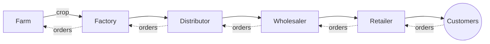
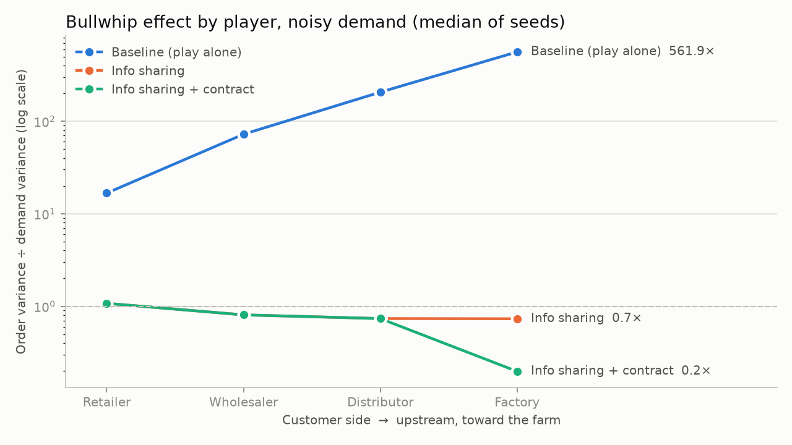
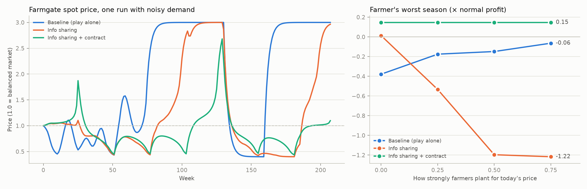
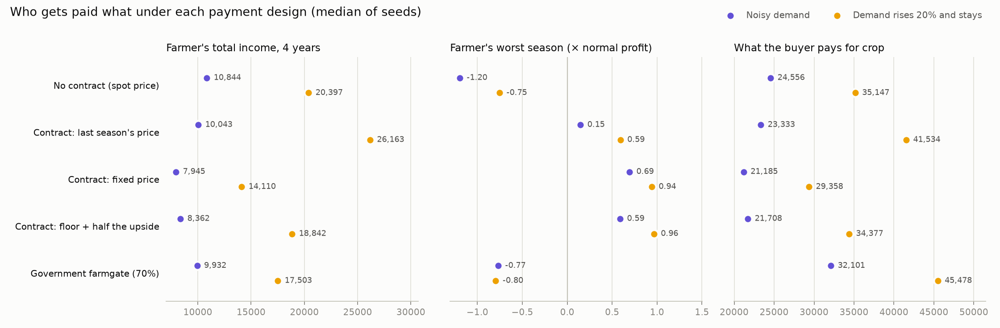
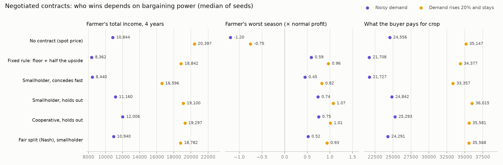

# Who Carries the Risk? Coordination, Contracts and Bargaining Power in a Farm-to-Shelf Supply Chain

**careneA** · Personal research project · November 2026

**[Try the interactive demo](demo/)** · **[Code and how to run it](README.md)**

---

## Summary

Supply chain planning is moving toward software agents that share data and
negotiate across companies. Most models of this future stop at the factory
and treat raw materials as unlimited. Farmers, who are the most exposed
players in a food supply chain, are left out.

I built a simulation of a five-player food supply chain that starts at the
farm, with seasonal planting, uncertain harvests, spoilage and a farmgate
price that moves with scarcity. I then tested how three kinds of
coordination change outcomes for the chain and for the farmer: sharing
demand data, supply contracts, and negotiated contracts.

In this model:

1. **The bullwhip effect is worst at the farm.** When each player sees only
   its neighbor's orders, the factory's orders to the farm vary over 500 times
   more than what customers buy.
2. **Sharing demand data calms the chain, but not the farmer's income.**
   Farmers still plant for today's price, and the resulting boom-and-bust
   price cycle gives them losing seasons.
3. **A commitment to buy a set quantity is what protects farmers.** Every
   contract design kept the farmer's worst season profitable. A fixed farmgate
   price without a quantity commitment did not.
4. **Bargaining power decides who keeps the gains.** With the same contract
   structure, a smallholder who needs a deal fast earned 23% less than a
   neutral "fair split." A cooperative that could afford to hold out earned 10%
   more than the fair split.

In a first test, an AI model (Claude) negotiating for the smallholder
bargained almost exactly like the farmer who concedes fast.

The main lesson for AI-driven coordination is that sharing information
isn't enough. Who commits to what, and who has the power to wait, decides
whether farmers benefit.

---

## 1. Question

The classic **Beer Game**, developed at MIT, shows how small changes in
customer demand grow into large swings in orders as they travel up a supply
chain. This is the **bullwhip effect** (Sterman 1989; Lee, Padmanabhan &
Whang 1997). The game has four players and stops at the factory, which gets
unlimited raw material.

Food supply chains start with farmers, who are different from factories:

- They decide what to plant months before they can sell it.
- Weather and disease decide the harvest, not the farmer.
- Their product spoils.
- They are many and small, and they sell to a few large buyers.

**Research question:** When a food supply chain coordinates through shared
data, contracts or negotiating agents, what happens to the farmer, and who
carries the risk?

## 2. Model



Each simulated week, goods arrive, players receive orders, ship what they
can, and place new orders. The model runs for 208 weeks (four years). Each
setup is run with 30 random seeds, and the report shows medians.

| Part | How it works |
|---|---|
| Downstream players | Ordering rule fitted to how people play the Beer Game (Sterman 1989). They correct inventory gaps slowly and underweight orders they've already placed. |
| Farm | Plants once per 26-week season. Harvest = planted × a random yield (±15%). Crop spoils after 30 weeks. Land caps planting at 1.6× a normal season. |
| Farmgate price | Rises when buyers want more crop than the farm can supply before the next harvest, falls in a glut. Between 0.4× and 3× normal. Growing costs 0.6 per unit; a balanced market pays 1.0. |
| Farmer behavior | Plants more when recent prices are high. This creates the "hog cycle" or cobweb pattern (Ezekiel 1938). |
| Customer demand | Three patterns: steady with noise, a lasting 20% rise, and an 8-week burst of panic buying (+60%). |

**Key measures:** the bullwhip ratio (variance of a player's orders ÷
variance of customer demand), weeks with empty shelves, farmer income, the
**farmer's worst season** (profit as a multiple of a normal season's profit;
below zero is a loss), and what the buyer pays for crop.

## 3. Findings

### 3.1 The bullwhip effect is worst at the farm



When every player sees only the orders it receives, swings grow at each step
upstream. With steady customer demand, the bullwhip ratio is 17× at the
retailer, 72× at the wholesaler, 206× at the distributor and **562× at the
factory**, which is what the farm sees. After a lasting 20% rise in demand,
shelves are empty in 24% of weeks. The farm can't replant until next season,
so a short shock becomes a shortage lasting months.

When every player sees real customer demand and counts what it has already
ordered, the ratio stays near 1× at every stage and shelves are almost never
empty.

| Steady demand | Play alone | Share demand data |
|---|---|---|
| Bullwhip at factory | 562× | 0.7× |
| Weeks with empty shelves | 8.6% | 0.3% |
| Whole-chain cost | 543k | 154k |

### 3.2 Sharing data calms the chain, but not the farmer



With shared data, orders are calm, but farmers still decide what to plant
from recent prices. High prices lead to heavy planting, the harvest arrives
months later into a glut, the price falls to its floor, and farmers cut
back. The left panel shows this cycle in one run. The farmer's worst season
under data sharing is a loss of **1.2× a normal season's profit**.

The right panel tests how much this depends on the price-chasing assumption.
The more strongly farmers plant for today's price, the worse their worst
season gets under data sharing alone. Under a contract, it stays positive at
every setting.

The chaotic "play alone" chain paid the farmer the most overall (21.6k
versus 10.8k), because constant shortages kept prices high. The rest of the
chain paid for it with empty shelves and a 3.5× higher total cost. A calmer
chain gives farmers stability, not more money.

### 3.3 A quantity commitment, not a fixed price, protects farmers



I compared five ways of paying the farmer. All share demand data, so only
the payment rule changes.

| Steady demand | Farmer income | Worst season | Buyer pays |
|---|---|---|---|
| No contract (spot price) | 10.8k | −1.20 | 24.6k |
| Contract at last season's average price | 10.0k | 0.15 | 23.3k |
| Contract at a fixed price | 7.9k | **0.69** | **21.2k** |
| Contract: floor of 0.8 + half of any price rise | 8.4k | 0.59 | 21.7k |
| Government-set farmgate price (70% of market) | 9.9k | −0.77 | 32.1k |

- **Every contract keeps the worst season profitable.** The four contracts
  produce identical plantings and shortages. The price rule only decides who
  gets the money.
- **A fixed price is safest but shuts the farmer out of good times.** After a
  lasting demand rise, the farmer earns 14.1k with a fixed price versus 26.2k
  with last season's price.
- **A set farmgate price without a quantity commitment does the worst job.**
  The worst season was still a loss even at 100% of the market price. Farmers
  had no guaranteed sale and planted for a price that was a season out of date.
  At 50% of market, shelves were empty in 13–29% of weeks. The farmer
  received about 70% of what the buyer paid.

The stability comes from the **commitment to buy a set quantity**, not from
fixing the price.

### 3.4 Bargaining power decides who keeps the gains



In the last experiment, the factory and the farm **negotiate** the contract
each season. They bargain over the price floor and the farmer's share of
price rises, taking turns making offers for up to 10 turns. Each side has
private information: the farmer knows its costs and how much it fears a bad
season, and the factory knows how much a guaranteed supply is worth to it.
Negotiators concede over time, toughly or eagerly (Faratin, Sierra & Jennings
1998). As a benchmark, the **fair split** is the Nash bargaining solution
(Nash 1950): the terms that maximize the product of both sides' gains over
walking away.

| Steady demand | Farmer's average price | Farmer income | Worst season | Buyer pays |
|---|---|---|---|---|
| Smallholder, concedes fast | 1.08 | 8.4k | 0.45 | 21.7k |
| Fair split (Nash), smallholder | 1.19 | 10.9k | 0.52 | 24.3k |
| Smallholder, holds out | 1.21 | 11.2k | 0.74 | 24.8k |
| Cooperative, holds out | 1.27 | 12.0k | 0.75 | 25.3k |

- **The same contract can be fair or unfair.** A smallholder who needs a deal
  fast ends up 23% below the fair split. Every deal still protects its worst
  season, but the factory keeps more of the gains.
- **Patience is the farmer's biggest lever.** The same smallholder holding out
  gets the fair split or better. This held with 6, 10 or 20 turns and against
  tough, balanced and eager factories.
- **A cooperative's value is that it can afford to hold out.** It has a better
  fallback (the full spot price) and can absorb a bad season, so its patience
  is credible.
- **Two tough sides sometimes fail to agree.** After a lasting demand rise,
  the cooperative and the factory agreed in only 75% of seasons.
- **The "balanced-looking" fixed rule is factory-friendly.** The floor + half
  the upside rule from Section 3.3 gave the same price (1.08) as the weakest
  negotiator.

### 3.5 First test: an AI model as the farmer's negotiator

I ran one 2-year game (4 seasons, steady demand) with Claude, Anthropic's AI
model, negotiating for the smallholder against the tough rule-based factory.
Claude saw its private costs, its fallback, recent market prices, and what
each offer would mean for its side. It could also send messages. I then
replayed its deals through the same simulation as the rule-based negotiators.

| Same game | Deals by season | Farmer income | Worst season |
|---|---|---|---|
| Claude as the farmer | fixed 1.00 · 1.00 + 20% of rises · fixed 1.00 · floor 0.80 + 90% | 2,449 | 0.39 |
| Rule-based, concedes fast | fixed 1.00 · fixed 1.00 · fixed 1.00 · floor 0.80 + 100% | 2,444 | 0.39 |
| Fair split (Nash) | | 2,832 | 0.63 |
| Rule-based, holds out | | 3,371 | 0.76 |

**Claude negotiated almost exactly like the smallholder who concedes fast.**
In the third season it accepted the factory's opening offer immediately. Its
messages were cooperative and accurate: it argued for protection against bad
seasons and never misstated its position. It also never threatened to walk
away, which is the move that gives the patient negotiators their advantage.
The result was 14% below the fair split.

This is one game, so it is an observation, not a finding. It does raise a
question for agent-based supply chains: **an AI agent acting for a weak party
may need explicit instructions about patience and walking away, or it will
leave value on the table.** The full transcript is in
[`results/negotiation_smallholder_claude_farm.json`](results/negotiation_smallholder_claude_farm.json).

## 4. Discussion

**Information is not coordination.** Shared data removes most of the
bullwhip effect, but it doesn't change the farmer's incentives. Planting is
still a bet on next season's price. Proposals for AI agents that coordinate
supply chains often focus on visibility. In this model, the farmer's outcomes
depend on commitments, not visibility.

**Commitments move risk, and someone has to carry it.** Contracts protect
the farmer because the buyer takes the quantity risk. The factory's costs
rise as a result. Whether that trade is worth it depends on how much the
buyer values a reliable supply.

**Agents inherit the power of the people they represent.** Automated
negotiation doesn't make outcomes fair by itself. An agent for a smallholder
that needs cash will concede like that smallholder. For farmers to benefit
from agent-based coordination, the agent needs a credible alternative, which
is what a cooperative provides.

## 5. Limits

These are model results, not forecasts or claims about real markets.

- **Illustrative parameters.** Costs, risk preferences, price sensitivity and
  the value of a guaranteed supply are chosen to be plausible, not measured.
  Key findings were checked across several settings (Sections 3.2–3.4), but
  the exact numbers will change with different values.
- **One farm, one product, one buyer per link.** Real chains have many farms
  and several competing buyers.
- **A simple price model.** Prices only affect the farmer. Consumers don't
  buy less when prices rise.
- **Simple negotiators.** They judge offers by replaying last year's prices,
  and they don't forecast or learn about the other side.
- **The government farmgate scheme is simplified.** In reality, part of the
  margin pays for logistics, stabilization funds and taxes.
- **Human-like ordering.** It uses average behavior from Beer Game
  experiments, and real players vary a lot.

## 6. Next steps

1. **More AI negotiation games.** Repeat the Claude game across many seeds and
   demand patterns, put Claude on the factory side, and play Claude against
   Claude. Test whether telling the farmer's agent about its fallback and the
   value of patience changes how it bargains.
2. **Many farms.** Split the farm into several smallholders and let them form
   a cooperative. Who joins, and does it hold together when a member gets a
   side deal?
3. **Negotiate quantity too,** with penalties for under-delivery.
4. **Real data.** Calibrate prices and yields to a real crop, such as cocoa.

## References

- Cachon, G. P. (2003). Supply chain coordination with contracts. In *Handbooks in Operations Research and Management Science*, Vol. 11, 227–339.
- Ezekiel, M. (1938). The cobweb theorem. *Quarterly Journal of Economics*, 52(2), 255–280.
- Faratin, P., Sierra, C., & Jennings, N. R. (1998). Negotiation decision functions for autonomous agents. *Robotics and Autonomous Systems*, 24(3–4), 159–182.
- Lee, H. L., Padmanabhan, V., & Whang, S. (1997). Information distortion in a supply chain: The bullwhip effect. *Management Science*, 43(4), 546–558.
- Nash, J. F. (1950). The bargaining problem. *Econometrica*, 18(2), 155–162.
- Sterman, J. D. (1989). Modeling managerial behavior: Misperceptions of feedback in a dynamic decision making experiment. *Management Science*, 35(3), 321–339.

## Reproduce

Every number and chart in this report comes from three scripts. Each runs in
seconds and needs no API key:

```bash
.venv/bin/python run_experiments.py      # Sections 3.1–3.2
.venv/bin/python compare_contracts.py    # Section 3.3
.venv/bin/python compare_negotiation.py  # Section 3.4
```

See the [README](README.md) for setup.
